<p align="center">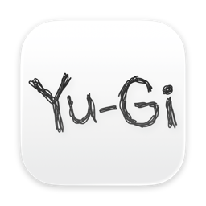</p>

<h1 align="center">YugiTokenBar</h1>

<p align="center">코딩 에이전트(Claude Code, Codex 등)가 쓴 토큰으로 <strong>유희왕 카드 컬렉션</strong>을 채우는 macOS 메뉴바 앱입니다.<br>
한국어, 영어, 일본어를 지원합니다.</p>

<p align="center"><a href="README.md">English</a> · <strong>한국어</strong> · <a href="README.ja.md">日本語</a></p>

## 어떻게 동작하나요

- 이 Mac에 남은 Claude Code, Codex, Gemini, Grok, Pi, oh-my-pi, Cursor 로그에서 오늘 쓴 토큰을 읽습니다.\
  처음 실행할 때는 지난 14일 사용량도 함께 적립하고, 그보다 오래된 사용량은 세지 않습니다.
- 10,000토큰이 1코인입니다.\
  1,000코인(= 1,000만 토큰)으로 카드 5장이 든 부스터 팩 하나를 삽니다.\
  팩을 10개 사면 무작위 팩 하나를 덤으로 받습니다.
- 컬렉션은 정규 부스터 101팩과 듀얼리스트 팩 30팩(DP 표시)이고, 시대별로 묶여 있습니다.
- 1,000만 토큰마다 무료 카드 한 장을 받습니다.\
  전체 카드 중에서 레어도 확률에 따라 뽑힙니다.
- 레어도는 N / R / SR / UR / SE입니다.\
  재록된 카드는 가장 높은 레어도를 따릅니다.
- 설정에서 카드를 뽑을 시대 범위를 고릅니다(DM … Modern, 기본값 GX).
- 같은 카드를 몇 장이든 모을 수 있습니다.\
  남는 카드는 코인으로 팔 수 있습니다.
- 26장은 일러스트가 카드 틀 밖으로 튀어나오는 공식 오버프레임 그림이 있습니다.\
  같은 카드를 3장 모으면 오버프레임 그림이 해금되고, 나중에 팔아도 해금은 유지됩니다.\
  해금 전에는 그 카드를 중복 카드로 팔거나 융합 소재로 쓰지 않으며, 도감에 ✦ 배지와 진행도가 표시됩니다.
- 팩의 카드를 모두 모으면, 아직 필요한 카드(해금 전 오버프레임 카드, 모자란 융합 소재)가 같은 레어도의 다른 카드보다 10배 자주 나옵니다.\
  그런 팩에서 나온 카드는 3배 값에 팔립니다.
- 하루에 5,000만 토큰을 쓰면 무료 카드 5장과 팩 5개를 살 코인을 받습니다.

## 화면

- **메뉴바**: 코인과 아직 열지 않은 무료 카드 배지를 보여 줍니다.\
  설정에서 오늘 사용량, Claude/Codex 한도, 도감 진행도, 또는 아무것도 표시하지 않도록 바꿀 수 있습니다.
- **팝오버**: 코인, 다음 무료 카드까지의 진행도, 최근 카드, 빠른 구매, 오늘 사용량과 비용, Claude/Codex 한도
- **Shop**: 시대별로 묶은 팩, 마우스를 올리면 구매
- **팩 개봉**: 카드를 한 장씩 뒤집기
- **Dex**: 팩별 진행도, 레어도별 보기, 카드 정보, 판매

업무 모드는 카드 이미지와 파트너 캐릭터를 숨깁니다.
설정에서 켤 수 있습니다.

<table align="center">
<thead><tr><th></th><th>업무 모드 끔</th><th>업무 모드 켬</th></tr></thead>
<tbody>
<tr><th>메뉴바</th><td valign="top" align="center">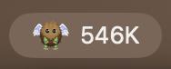</td><td valign="top" align="center">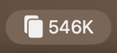</td></tr>
<tr><th>팝오버</th><td valign="top" align="center">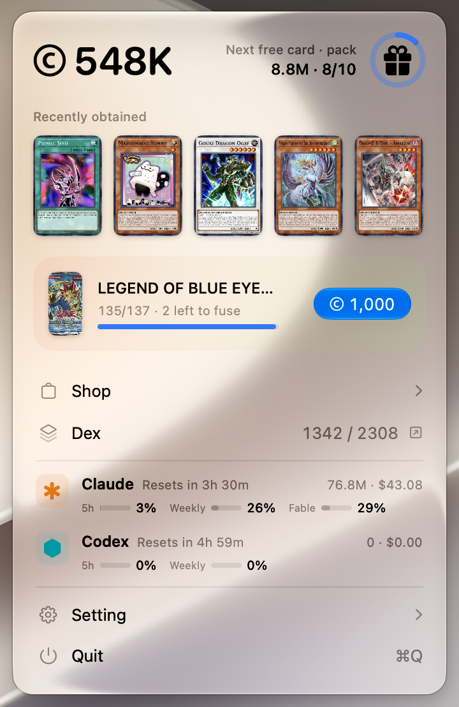</td><td valign="top" align="center">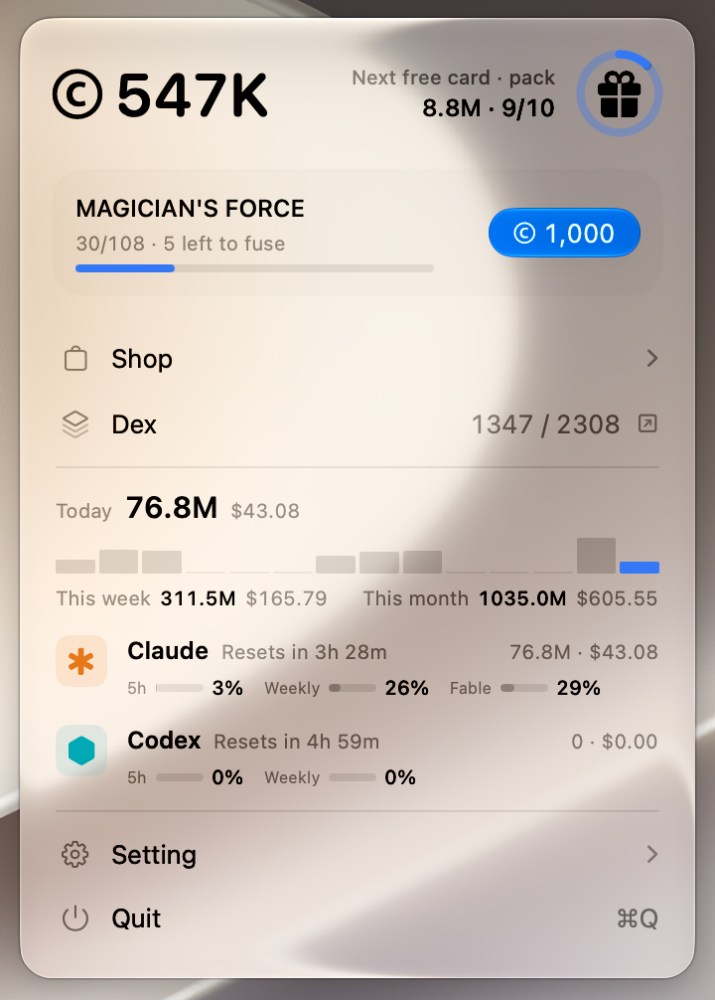</td></tr>
<tr><th>Shop</th><td valign="top" align="center">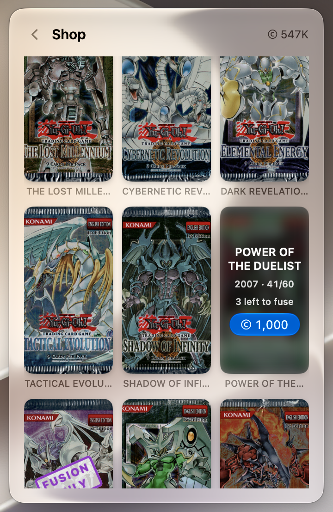</td><td valign="top" align="center">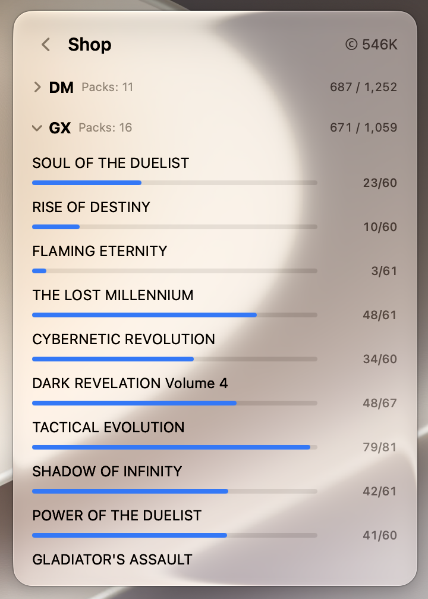</td></tr>
<tr><th>팩 개봉</th><td valign="top" align="center">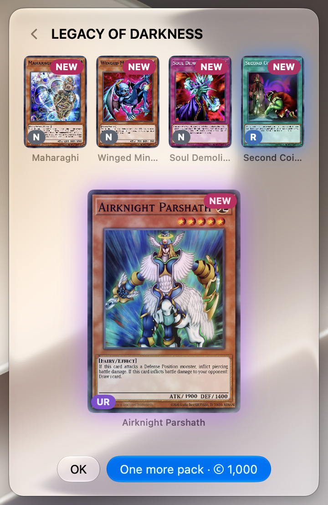</td><td valign="top" align="center">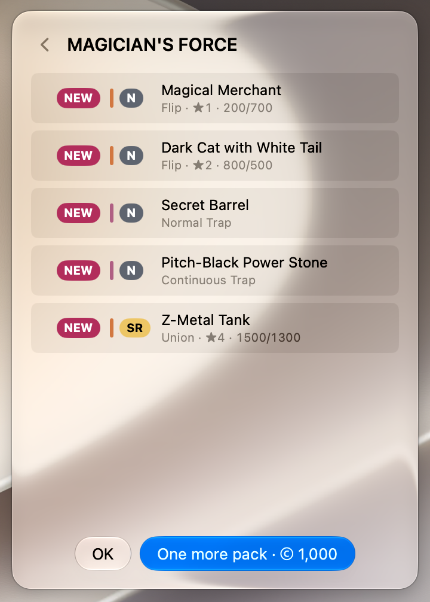</td></tr>
<tr><th>사용량</th><td valign="top" align="center">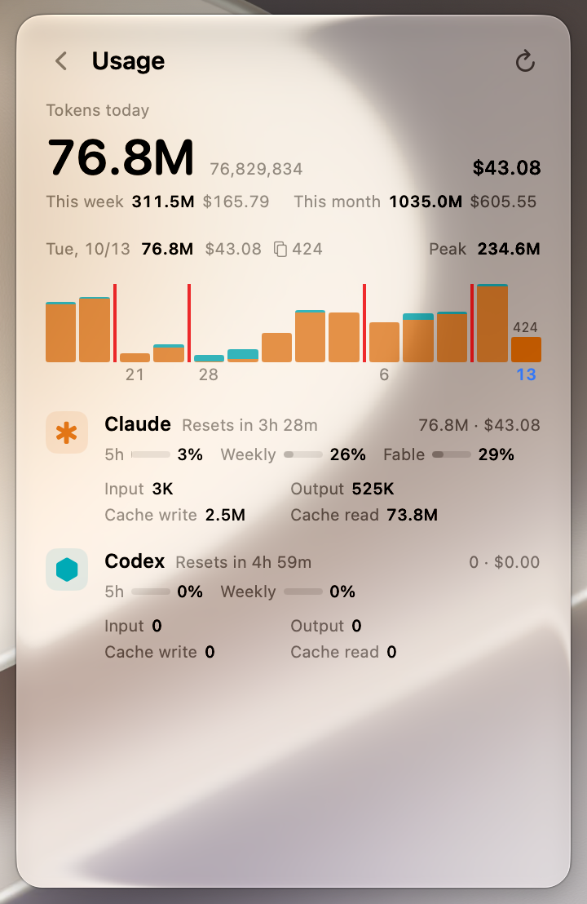<br>오늘의 토큰 사용량</td><td valign="middle" align="center">같음</td></tr>
<tr><th>필드 배경</th><td valign="top" align="center">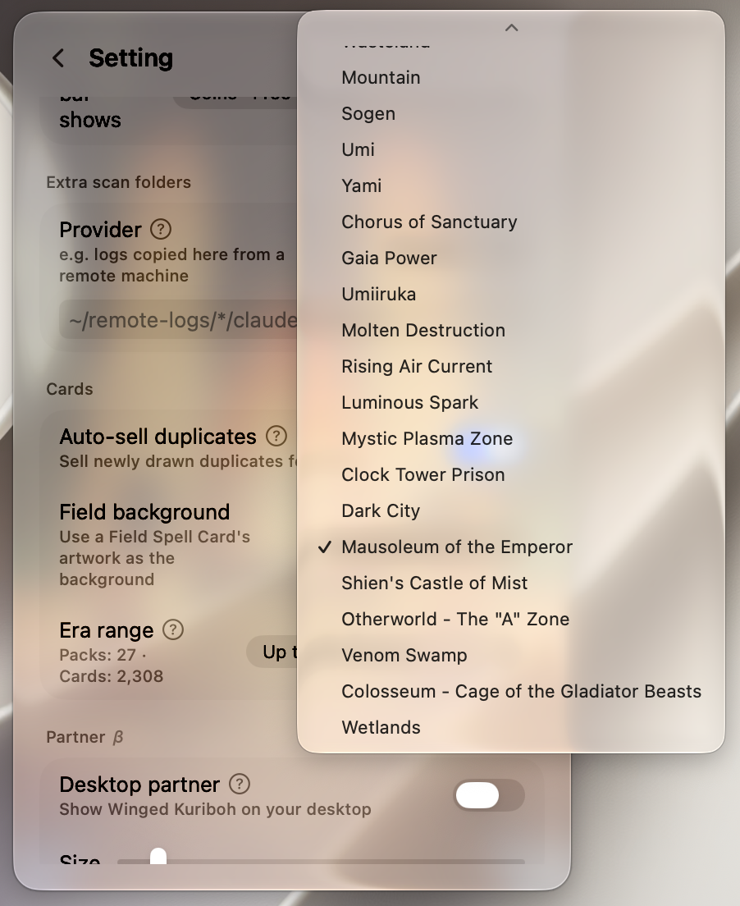</td><td valign="middle" align="center">없음</td></tr>
</tbody>
</table>

<table align="center">
<tbody>
<tr><th>Dex · 업무 모드 끔</th></tr>
<tr><td align="center">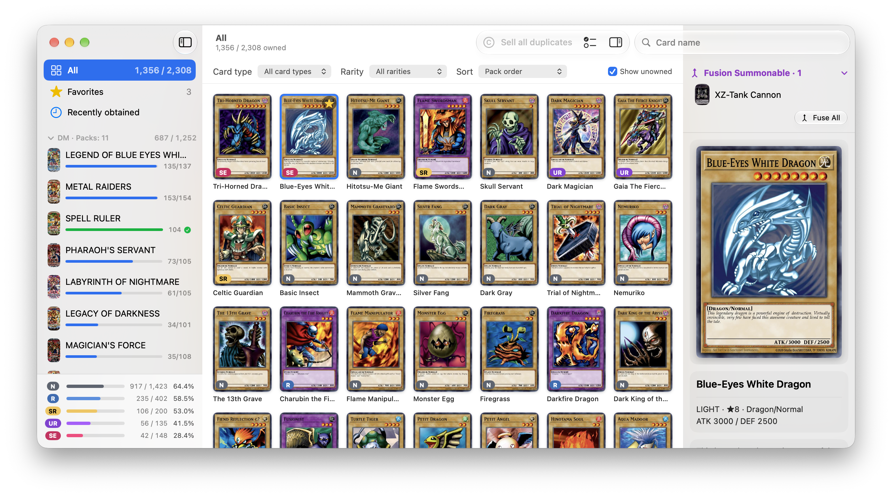</td></tr>
<tr><th>Dex · 업무 모드 켬</th></tr>
<tr><td align="center">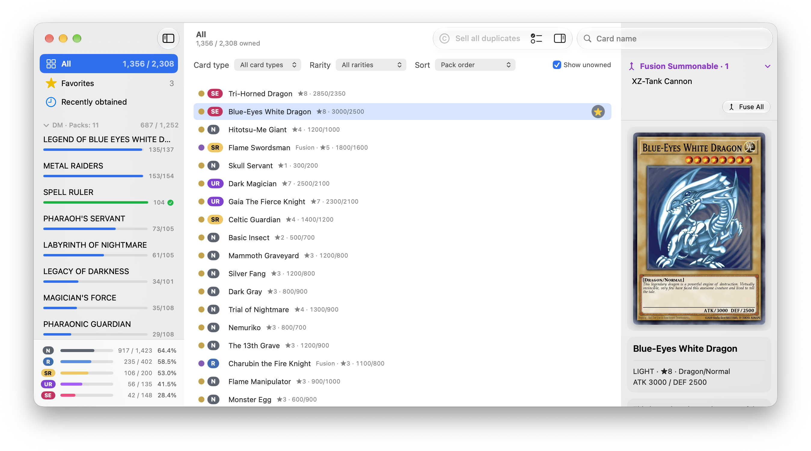</td></tr>
</tbody>
</table>

<table align="center">
<thead><tr><th>오버프레임 미해금 (1/3)</th><th>오버프레임 해금</th></tr></thead>
<tbody>
<tr><td align="center">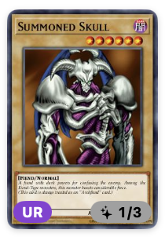</td><td align="center">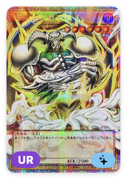</td></tr>
</tbody>
</table>

소재 카드로 만들 수 있는 융합 몬스터는 팩에서 뽑는 대신 소재를 융합해서 얻습니다.

<p align="center"><a href="docs/video/fusion-demo.mp4">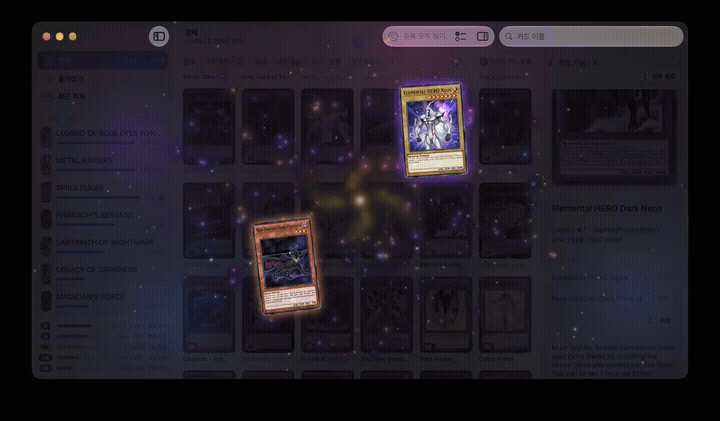</a></p>

## 원격 머신

원격 머신(SSH, 클라우드 세션)에서 쓴 사용량은 그 머신에 로그가 남기 때문에 앱이 볼 수 없습니다.
임시 방편으로, 로그를 이 Mac으로 복사한 뒤 설정 > 추가 스캔 폴더에 그 폴더를 넣어 주세요:

```bash
# 몇 분마다 (cron/launchd); -a로 파일 시각을 유지
rsync -a gpu1:~/.claude/projects/ ~/remote-logs/gpu1/claude/projects/
rsync -a gpu1:~/.codex/sessions/  ~/remote-logs/gpu1/codex/sessions/
```

그다음 Claude에는 `~/remote-logs/*/claude/projects`, Codex에는 `~/remote-logs/*/codex/sessions`를 지정합니다.
macOS가 접근 권한을 묻지 않도록 폴더는 문서, 데스크탑, 다운로드 밖에 두세요.
같은 요청이 여러 폴더에 있어도 한 번만 셉니다.
자정이 지나서 동기화된 사용량은 전날로 적립되지 않습니다.

## 설치

macOS 26 이상이 필요합니다.
[최신 릴리스](https://github.com/Dodant/YugiTokenBar/releases/latest)의 **Assets**에서 `YugiTokenBar-x.y.z-macOS.zip`을 내려받아 압축을 풀고, 앱을 `/Applications`로 옮기세요.
GitHub가 릴리스마다 붙이는 **Source code** 압축 파일은 앱이 아니라 소스 코드입니다.
0.6.3의 앱 ZIP은 `YugiTokenBar-0.6.3.zip`(약 11 MB)입니다.
앱이 Apple 공증을 받지 않아서 처음 열 때 macOS가 막습니다.
아래 둘 중 한 가지 방법으로 한 번만 허용해 주세요:

- **시스템 설정:** 앱을 연 다음 **개인정보 보호 및 보안**에서 YugiTokenBar 옆의 **그래도 열기**를 누릅니다.
- **터미널:** `xattr -dr com.apple.quarantine /Applications/YugiTokenBar.app`

업데이트한 뒤에는 Claude 한도를 읽기 위해 macOS가 키체인 접근을 다시 물을 수 있습니다.
업데이트는 설정 > 정보 & 지원의 [업데이트 확인]으로 합니다.
모은 컬렉션은 그대로 남습니다.

## 크레딧

- 카드 데이터: [코나미 공식 카드 데이터베이스](https://www.db.yugioh-card.com/yugiohdb/?request_locale=ko)
- 대부분의 카드 이미지: [YGOPRODeck](https://ygoprodeck.com/)
- 일부 오버프레임 이미지: [Yugipedia](https://yugipedia.com/), 그리고 [CardRush](https://www.cardrush.jp/)·[Blue Rabbit](https://www.rabbit-blue.com/) 카드숍 스캔
- 팩 이미지: [Yugipedia](https://yugipedia.com/)
- 사용량 읽기 코드: [PokeTokenBar](https://github.com/chattymin/PokeTokenBar) (MIT, © 2026 chattymin)

> YugiTokenBar는 비공식·비영리 팬 프로젝트입니다.
> 코나미와 관련이 없으며, 코나미의 보증·후원·승인을 받지 않았습니다.
> 유희왕 카드 이름, 텍스트, 이미지의 저작권은 코나미에 있습니다.

## 라이선스

코드는 [MIT 라이선스](LICENSE)를 따릅니다.
카드 데이터, 카드 이미지, 카드 뒷면, 파트너 스프라이트는 코나미의 저작물이거나 그 팬아트이므로 MIT 라이선스가 적용되지 않습니다.
