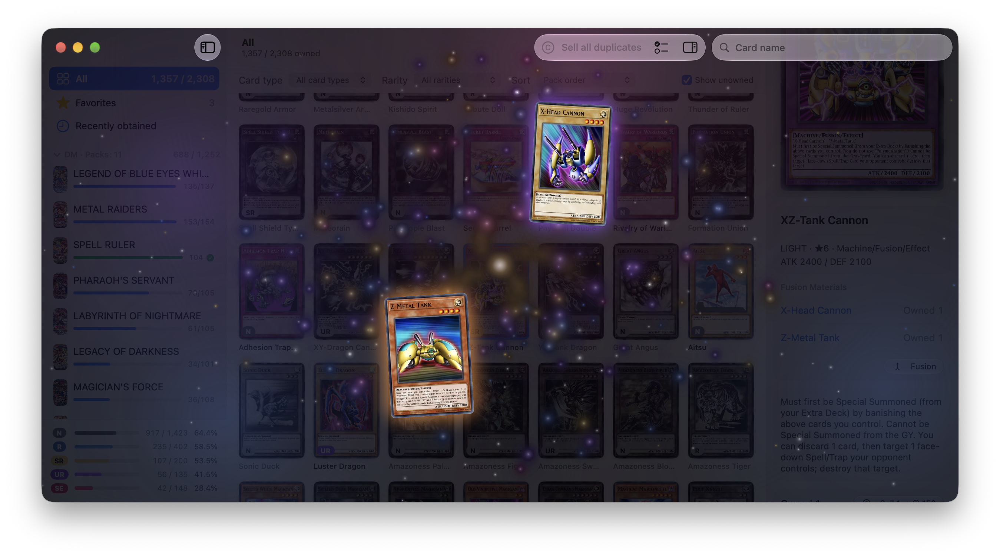
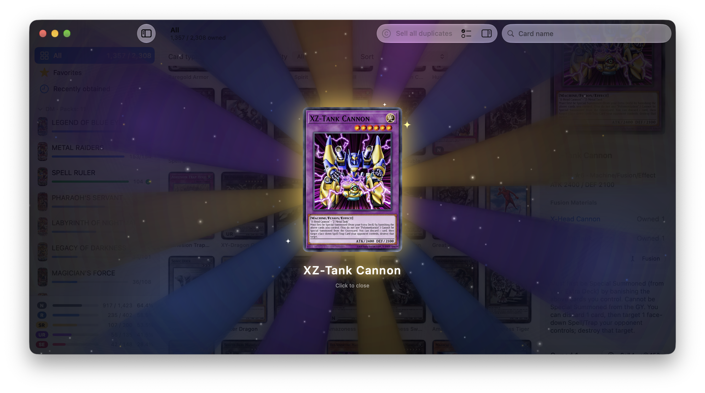

<h1 align="center">YugiTokenBar</h1>

A macOS menu bar app that fills a <strong>Yu-Gi-Oh! card collection</strong> with the tokens your coding agents (Claude Code, Codex, etc.) use. 
Available in Korean, English, and Japanese.

## How it works

- It reads today's tokens from your local Claude Code and Codex session logs. Usage from before installation is not counted.
- 10,000 tokens = 1 coin.
  1,000 coins (= 10M tokens) buy one booster pack with 5 cards.
  Buy 10 packs and you get a random pack for free.
- Every 10M tokens you earn a free card, drawn from the whole pool by rarity odds.
- Rarities are N / R / SR / UR / SE. A reprinted card takes its highest rarity.
- In Settings, pick how far the pools reach (DM … Modern, default GX).
- You can collect any number of copies. Extra cards sell for coins.
- Using 50M tokens a day earns 5 free cards + enough coins for 5 packs.

## Screens

- **Menu bar**: coins and a badge for unopened free cards
- **Popover**: coins, progress to the next free card, recent cards, quick buy, today's usage and cost, and Claude/Codex limits
- **Shop**: packs grouped by era; hover to buy
- **Pack**: flip cards one by one
- **Dex**: per-pack progress, view by rarity, card info, selling

Work mode hides card images and the partner character; enable it in Settings.

<table align="center">
<thead><tr><th></th><th>Work mode off</th><th>Work mode on</th></tr></thead>
<tbody>
<tr><th>Menu bar</th><td valign="top" align="center"></td><td valign="top" align="center"></td></tr>
<tr><th>Popover</th><td valign="top" align="center"></td><td valign="top" align="center"></td></tr>
<tr><th>Shop</th><td valign="top" align="center"></td><td valign="top" align="center"></td></tr>
<tr><th>Pack</th><td valign="top" align="center"></td><td valign="top" align="center"></td></tr>
<tr><th>Usage</th><td valign="top" align="center"> Today's token usage</td><td></td></tr>
</tbody>
</table>

<table align="center">
<thead><tr><th colspan="2">Dex</th></tr><tr><th>Work mode off</th><th>Work mode on</th></tr></thead>
<tbody><tr>
<td valign="top" align="center"></td>
<td valign="top" align="center"></td>
</tr></tbody>
</table>

Enable fusion-only collection in Settings to obtain eligible Fusion Monsters by combining material cards instead of drawing them.

<table align="center">
<thead><tr><th>Before fusion (Fusion On)</th><th>After fusion (Fusion On)</th></tr></thead>
<tbody><tr>
<td valign="top" align="center"> Materials before fusion</td>
<td valign="top" align="center"> Result after fusion</td>
</tr></tbody>
</table>

## Install

Requires macOS 26 or later.
There is no public release yet; once one is published, download `YugiTokenBar-x.y.z.zip` from [Releases](https://github.com/Dodant/YugiTokenBar/releases), unzip it, and move the app to `/Applications`.
To update, quit the app and replace it. Your collection is kept.

## Credits

- Card data: [Konami official card database](https://www.db.yugioh-card.com/yugiohdb/?request_locale=ko)
- Most card images: [YGOPRODeck](https://ygoprodeck.com/)
- Some over-frame images: [Yugipedia](https://yugipedia.com/) and card shop scans from [CardRush](https://www.cardrush.jp/) and [Blue Rabbit](https://www.rabbit-blue.com/)
- Pack images: [Yugipedia](https://yugipedia.com/)
- Usage-reading code: [PokeTokenBar](https://github.com/chattymin/PokeTokenBar) (MIT, © 2026 chattymin)

> YugiTokenBar is an unofficial, non-commercial fan project.
> It is not affiliated with, endorsed, sponsored, or approved by Konami.
> Yu-Gi-Oh! card names, text, and images are © Konami.
